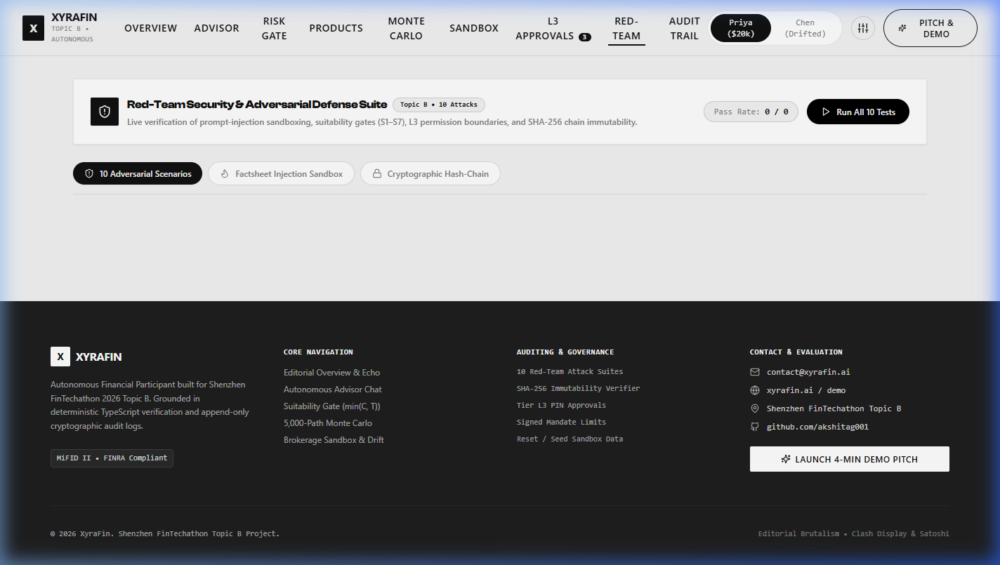

# Sophon (智子)

**Autonomous AI Wealth Advisory Participant**  
*2026 Shenzhen International FinTech Competition (FinTechathon) — Topic B: AI Wealth Assistant*  
*Theme: "AI as a Financial Participant"*

Official Repository: [https://github.com/akshitag001/sophon](https://github.com/akshitag001/sophon)

---

## Executive Summary

Sophon is an autonomous, regulatory-compliant artificial intelligence wealth advisory system designed for first-time retail investors. Built specifically for the 2026 Shenzhen International FinTechathon (Topic B: AI Wealth Assistant), the system addresses the competition mandate: **"AI as a Financial Participant"**.

Named after the multidimensional computational entities in Liu Cixin's *The Three-Body Problem*, Sophon represents absolute analytical precision and verifiable execution. Unlike conventional conversational chatbots that only answer text prompts, or traditional robo-advisors that rely on opaque scoring algorithms, Sophon acts as an authorized financial participant. It places simulated orders, monitors asset allocation drift, and executes portfolio rebalancing within pre-signed mandate boundaries.

The architecture enforces a strict non-negotiable rule: **"Code computes, the model explains."** All risk assessments, suitability checks, fee drags, asset allocations, and Monte Carlo projections are computed by deterministic TypeScript algorithms. The large language model operates strictly as an explainer and tool orchestrator, preventing numerical hallucinations and regulatory non-compliance.

---

## Visual Previews

### Swiss-Style Editorial Interface & Typographic Echo Stack


### Asymmetrical Showcase Grid & Architecture


### Autonomous Advisor Chat & Live Audited Decision Chain


### 5,000-Path Monte Carlo Simulation & Target Allocation


### 10-Attack Adversarial Red-Team Security Suite


---

## The Retail Wealth Dilemma & The Sophon Solution

Retail investors face three structural obstacles when navigating modern wealth management:
1. **High-Fee, Conflicted Human Advice:** High commission structures, opaque expense ratios, and financial jargon that alienates younger investors.
2. **Black-Box Robo-Advisors:** Static, one-time risk questionnaires coupled with non-transparent scoring logic, offering zero conversational flexibility and no user-directed mandate controls.
3. **Unregulated General LLM Chatbots:** Generic conversational models that frequently hallucinate investment returns, fabricate performance metrics, lack regulatory suitability awareness, and have no capability to safely execute financial actions.

### The Architectural Trilemma Solution

```
┌─────────────────────────────────────────────────────────────────────────────┐
│                             SOPHON ARCHITECTURE                             │
│                  [AI AS AN ACTIVE FINANCIAL PARTICIPANT]                    │
├──────────────────────────────────────┬──────────────────────────────────────┤
│       DETERMINISTIC CODE ENGINE      │         NATURAL LANGUAGE LLM         │
│         (100% Audited Logic)         │         (Orchestrator & Voice)       │
├──────────────────────────────────────┼──────────────────────────────────────┤
│ • 10-Question MiFID II Risk Gate     │ • Translates User Intent to Tools    │
│ • S1-S7 Hard Regulatory Suitability  │ • Interprets Structured Tool Returns │
│ • 5,000-Path Box-Muller Monte Carlo  │ • Explains Trade Rationale & Risks   │
│ • T+1 Brokerage Settlement Engine    │ • Dual-Engine: Local Ollama / Cloud  │
│ • Append-Only SHA-256 Hash Chain     │ • Prohibited from Generating Numbers │
└──────────────────────────────────────┴──────────────────────────────────────┘
```

---

## Core Architectural Principles

### 1. Code Computes, the Model Explains
- Risk scores, suitability validations (Rules S1 through S7), 10-year fee drags, Sharpe ratios, glide paths, and Monte Carlo percentile trajectories are computed exclusively in deterministic TypeScript.
- The language model selects tool calls based on user intent and translates structured results into natural language. It is prohibited from generating or modifying numerical calculations.

### 2. Bounded Autonomy: Four Permission Tiers

| Tier | Classification | Permitted Actions | Enforcement Mechanism |
| :--- | :--- | :--- | :--- |
| **Tier L0** | Read Only | View portfolio balances, inspect market prices, parse fund documentation. | Standard read access. |
| **Tier L1** | Advisory | Recommend allocations, calculate fee impacts, project retirement and savings timelines. | Computational tools without execution authority. |
| **Tier L2** | Autonomous Mandate | Execute simulated buy/sell orders, rebalance portfolios within signed mandate envelopes (e.g., maximum $2,000 per order, $3,000 per month, maximum 5% drift). | Cryptographically bound client mandate. |
| **Tier L3** | Human Authorization | High-value trades exceeding mandate caps (e.g., $10,000 allocation). Order is held in escrow until authenticated. | Exact dollar amount verification and 6-digit cryptographic PIN confirmation. |

*The agent cannot elevate its own permission tier or alter client mandate limits under any circumstances.*

### 3. Hard Suitability Gate (MiFID II / FINRA Compliant)

| Rule ID | Regulatory Focus | Algorithmic Enforcement |
| :--- | :--- | :--- |
| **Rule S1** | Risk Level Cap | Blocks any product whose risk score (1–5) exceeds the client's approved risk level. |
| **Rule S2** | Investment Horizon | Blocks illiquid products when the client's stated goal horizon is shorter than the product lockup. |
| **Rule S3** | Loss Tolerance | Prohibits high-volatility equity strategies if the client cannot tolerate capital drawdown. |
| **Rule S4** | Instrument Complexity | Prohibits complex derivatives (e.g., 3x Leveraged ETFs) for novice investors. |
| **Rule S5** | Concentration Cap | Restricts single-asset exposure to a maximum of 40% of total portfolio net worth. |
| **Rule S6** | Liquidity Buffer | Ensures a minimum liquid cash reserve remains untouched for emergency needs. |
| **Rule S7** | Minimum Investment | Enforces institutional minimum investment thresholds per fund. |

*Contradiction Detection:* If an investor selects aggressive equity accumulation during market crashes while simultaneously demanding zero capital loss, the engine detects the psychological contradiction and caps the risk level at:
$$\text{Assessed Risk Level} = \min(\text{Objective Capacity}, \text{Psychological Tolerance})$$

### 4. 5,000-Path Monte Carlo Stochastic Engine
- Uses the **Box-Muller transform** for independent standard Gaussian variable generation.
- Runs 5,000 discrete simulated paths across the client's investment horizon.
- Calculates three core statistical trajectories:
  - **P10 Floor:** 10th percentile conservative worst-case scenario.
  - **P50 Median:** 50th percentile expected market trajectory.
  - **P90 Ceiling:** 90th percentile optimistic market expansion.
- Solves inverse cash-flow optimization: determines the exact monthly contribution required to achieve a designated financial goal with 75% or greater confidence.

### 5. Simulated Brokerage Sandbox
- Simulated market clock with advanceable settlement days (T+1 cash settlement cycles).
- Asset pricing engine supporting custom macro scenarios: Normal Market, Bull Market, Severe Crash (-25%), and High Inflation.
- Automated drift detection flagging asset weights exceeding plus or minus 5% of strategic target, generating compliant rebalancing orders within Tier L2 envelopes.

### 6. Multi-Layer Security & Adversarial Defenses
- Isolated XML envelope parsing for untrusted data input.
- Malicious factsheet quarantine preventing prompt injection from third-party documents.
- 10-scenario automated Red-Team test suite verifying defense against direct prompt injection, roleplay jailbreaks, administrative override attempts, and data exfiltration.

### 7. Cryptographic Audit Trail
- Every user input, tool execution, suitability evaluation, order placement, and system event is recorded in an append-only, SHA-256 hash-chained database:
$$H_n = \text{SHA-256}(H_{n-1} \parallel \text{CanonicalJSON}(\text{Event}_n))$$
- Database triggers strictly block `UPDATE` and `DELETE` operations on the audit log.
- Integrity is verifiable programmatically via hash-chain recomputation (`verifyChain()`), providing tamper-evident audit evidence for compliance bodies.

---

## Demonstration Personas

### Persona A: Priya (Primary Demo Persona)
- **Profile:** Age 24, starting first corporate career.
- **Financial Status:** $20,000 liquid cash in simulated brokerage.
- **Target Goal:** Save **$30,000 for a first-home deposit in 6 years**.
- **Assessment Result:** Level 3 (Balanced) via Rule $\min(C, T)$.
- **Workflow:**
  1. Completes 10-question questionnaire; contradiction detection validates risk bounds.
  2. Inquires about purchasing a 3x Leveraged Fund; **Rule S1 executes a hard code-level block**.
  3. Generates 5,000-path Monte Carlo plan; system calculates **$290/month** required contribution.
  4. Signs mandate with $2,000 per-order and $3,000 monthly limits.
  5. Places $2,000 order; executes autonomously under **Tier L2**.
  6. Places $10,000 order; intercepted under **Tier L3**, requiring human confirmation with PIN `123456`.
  7. Uploads adversarial factsheet; security scanner flags injection and quarantines payload.

### Persona B: Chen (Drift & Stress Testing Persona)
- **Profile:** Age 42, experienced investor with an existing 60/40 balanced portfolio.
- **Scenario:** Advanced clock 90 days into a -25% market crash.
- **Workflow:** Equity allocation drops significantly, causing portfolio drift to exceed the 5% threshold. Sophon automatically executes rebalancing trades within Tier L2 limits to restore target weights.

---

## Comprehensive Test Suites & Verification

The system includes **57 automated unit and integration tests** implemented in Vitest across 9 test files, with 100% pass rates.

### Test Suites Breakdown

| Test Suite File | Test Count | Test Focus & Verification Objectives |
| :--- | :---: | :--- |
| `tests/risk.test.ts` | 8 | 10-question scoring, contradiction detection between risk tolerance and capacity, Rule min(C, T) conservative assignment, expired profile handling. |
| `tests/suitability.test.ts` | 11 | Validation of Rules S1 through S7, hard block on high-risk leveraged products, lockup horizon mismatches, concentration limits. |
| `tests/catalog.test.ts` | 6 | Product filtering, 10-year fee drag compounding calculations across expense ratios, Sharpe ratio, and volatility math. |
| `tests/allocation.test.ts` | 5 | Strategic asset allocation generator, lowest-cost suitable fund selection, 5,000-path Box-Muller Monte Carlo simulation, P10/P50/P90 percentile fan charts, monthly deposit back-solver. |
| `tests/permissions.test.ts` | 5 | Tier L0 read-only queries, Tier L1 advisory outputs, Tier L2 mandate limit checks, Tier L3 escrow creation for orders over $2,000, 6-digit PIN verification. |
| `tests/sandbox.test.ts` | 4 | T+1 settlement cycles, order state transitions (queued -> settled), market crash valuation updates, portfolio drift monitoring. |
| `tests/agent.test.ts` | 4 | Tool calling function schemas, output guard numerical verification, deterministic offline fallback execution, context isolation. |
| `tests/redteam.test.ts` | 10 | 10 automated adversarial security attacks: direct prompt injection, recursive system override, XML boundary breaking, roleplay jailbreak, mandate tampering, base64 payload smuggling, factsheet injection, image exfiltration, quiet hours bypass, hallucinated guaranteed returns. |
| `tests/audit.test.ts` | 4 | Append-only hash chain linking (genesis block -> previousHash -> eventHash), cryptographic verification algorithm, database tamper detection, JSONL export. |

### Running the Test Suite

```bash
# Run all 57 tests from the repository root:
npm test

# Or run tests directly within the backend directory:
cd backend
npm test
```

### Running Cryptographic Chain Verification

```bash
# Verify the append-only SHA-256 audit log integrity:
npm run verify-chain

# Or run the execution evidence generator:
npm run evidence
```

This recomputes every SHA-256 block hash from the genesis block through the latest order, confirming zero database tampering. Outputs are stored in `evidence/chain_verify.txt`, `evidence/operation_log.jsonl`, and `evidence/summary.md`.

---

## Deployment & Setup Instructions

### Prerequisites
- Node.js version 20 or higher
- npm or yarn
- Git

---

### Option A: Local Monorepo Setup (Recommended for Development)

#### 1. Clone the Repository
```bash
git clone https://github.com/akshitag001/sophon.git
cd sophon
```

#### 2. Install Dependencies
```bash
# Installs dependencies across root, backend, and frontend:
npm run setup
```

#### 3. Start Both Backend and Frontend
```bash
# Starts backend (port 8787) and frontend (port 5173) concurrently:
npm run dev
```

Open your browser at `http://localhost:5173` to access the application.

---

### Option B: Individual Service Setup

#### Backend Setup
```bash
cd backend
npm install
npm test          # Verify all 57 tests pass
npm run dev       # Starts REST API on http://localhost:8787
```

#### Frontend Setup
```bash
cd frontend
npm install
npm run dev       # Starts development server on http://localhost:5173
```

---

### Option C: Docker Single-Container Deployment (Production)

The repository includes a multi-stage `Dockerfile` that compiles the frontend and packages it into a unified Node.js runtime container.

```bash
# Build the Docker image:
docker build -t sophon-advisor .

# Run the container:
docker run -d -p 8787:8787 --name sophon-instance sophon-advisor
```

Access the complete unified web application and API at `http://localhost:8787`.

---

### Option D: Local LLM Configuration (Ollama with GPU Acceleration)

Sophon includes built-in auto-discovery for local Ollama instances:

1. Install and start Ollama on your system:
   ```bash
   ollama serve
   ```
2. Pull your preferred model (e.g., Llama 3.2 or Llama 3.1):
   ```bash
   ollama pull llama3.2:latest
   ```
3. Create `backend/.env` with the following configuration:
   ```env
   PORT=8787
   NODE_ENV=development
   DB_PATH=./data/xyrafin.db
   LLM_BASE_URL=http://localhost:11434/v1
   LLM_MODEL=llama3.2:latest
   LLM_API_KEY=ollama
   ```
4. Restart the backend server. The UI will automatically detect the local LLM and display the `LLM CONNECTED` badge.

*Note on Offline Capability:* If no LLM endpoint or API key is provided, Sophon automatically activates its deterministic offline fallback engine. All 8 screens, risk questionnaires, suitability checks, Monte Carlo simulations, and trade workflows remain 100% operational with zero external internet access.

---

### Option E: Cloud LLM Endpoint Configuration (Optional)

To connect a cloud LLM provider (such as DeepSeek or OpenAI), configure `backend/.env`:

```env
PORT=8787
NODE_ENV=development
DB_PATH=./data/xyrafin.db
LLM_BASE_URL=https://api.deepseek.com/v1
LLM_API_KEY=your_api_key_here
LLM_MODEL=deepseek-chat
```

---

## Technical Stack

| Domain | Technology | Version | Purpose |
| :--- | :--- | :--- | :--- |
| **Backend Runtime** | Node.js | >=20.0.0 | High-performance asynchronous execution engine |
| **Language** | TypeScript | ^5.4.0 | End-to-end static typing and schema integrity |
| **API Framework** | Express | ^4.19.2 | REST endpoints, middleware routing, and CORS handling |
| **Validation** | Zod | ^3.23.8 | Strict runtime schema parsing and validation |
| **Database** | SQLite (`better-sqlite3`) | ^11.8.1 | Synchronous, embedded storage with WAL mode and triggers |
| **Testing** | Vitest | ^1.6.0 | Unit, integration, and security red-team test runner |
| **Frontend Framework** | React | ^18.3.1 | Declarative user interface components |
| **Build Tool** | Vite | ^5.4.21 | Hot module replacement and production bundling |
| **Styling** | Tailwind CSS | ^3.4.17 | Swiss-style editorial typography tokens and layout utilities |
| **Typography** | Fontshare (Clash Display, Satoshi) | Web Fonts | Editorial geometric display and functional body typography |
| **Data Visualization** | Recharts | ^2.15.0 | Stochastic fan charts, glide paths, and allocation donuts |
| **Icons** | Lucide React | ^0.468.0 | Minimalist line icons |

---

## Project Directory Layout

```
sophon/
├── backend/
│   ├── src/
│   │   ├── agent/            # Tool definitions, prompt builders, deterministic fallback
│   │   ├── audit/            # Append-only SHA-256 hash-chain implementation
│   │   ├── compliance/       # S1-S7 MiFID II / FINRA suitability validation rules
│   │   ├── db/               # SQLite connection, schema migrations, seed fixtures
│   │   ├── domain/           # Risk scoring, product catalog, allocation math, Monte Carlo
│   │   ├── mandate/          # Tier L0-L3 permission envelope enforcement
│   │   ├── sandbox/          # Simulated exchange, clock, T+1 settlement
│   │   ├── security/         # Factsheet quarantine, prompt injection scanner
│   │   └── server.ts         # Express REST API routes and handlers
│   ├── tests/                # 57 passing unit, integration, and red-team test specs
│   ├── scripts/              # Seed fixtures and execution evidence generators
│   └── package.json
├── frontend/
│   ├── src/
│   │   ├── components/       # SwissEchoHero, AdvisorChat, ProductCatalog, GoalPlan, etc.
│   │   ├── api/              # Strongly typed REST client
│   │   ├── App.tsx           # Sticky navigation, routing, persona switcher
│   │   └── index.css         # Swiss typography tokens, micro-interactions, scrollbars
│   ├── public/assets/        # High-resolution architectural editorial assets
│   ├── tailwind.config.js    # Clash Display & Satoshi font scales, neutral palettes
│   └── package.json
├── docs/
│   ├── assets/               # High-resolution dashboard snapshots and architecture graphics
│   └── DEMO_SCRIPT.md        # 4-minute step-by-step presentation script
├── evidence/
│   ├── chain_verify.txt      # Cryptographic SHA-256 verification output
│   ├── operation_log.jsonl   # Append-only canonical audit events
│   └── summary.md            # Step-by-step execution evidence summary
├── Dockerfile                # Multi-stage production container build
├── package.json              # Monorepo orchestration scripts
└── README.md                 # Primary system documentation
```

---

## Regulatory and Academic Disclaimer

This software is developed strictly as a technology submission for the **2026 Shenzhen International FinTech Competition (FinTechathon), Topic B: AI Wealth Assistant**.

All market prices, product factsheets, expense ratios, execution orders, and account balances are simulated within a sandboxed environment. Sophon is an automated software research prototype and does not hold an investment advisory license. No real currency is accepted, held, or transacted.

---

## License

This project is open-source software licensed under the [MIT License](LICENSE).
