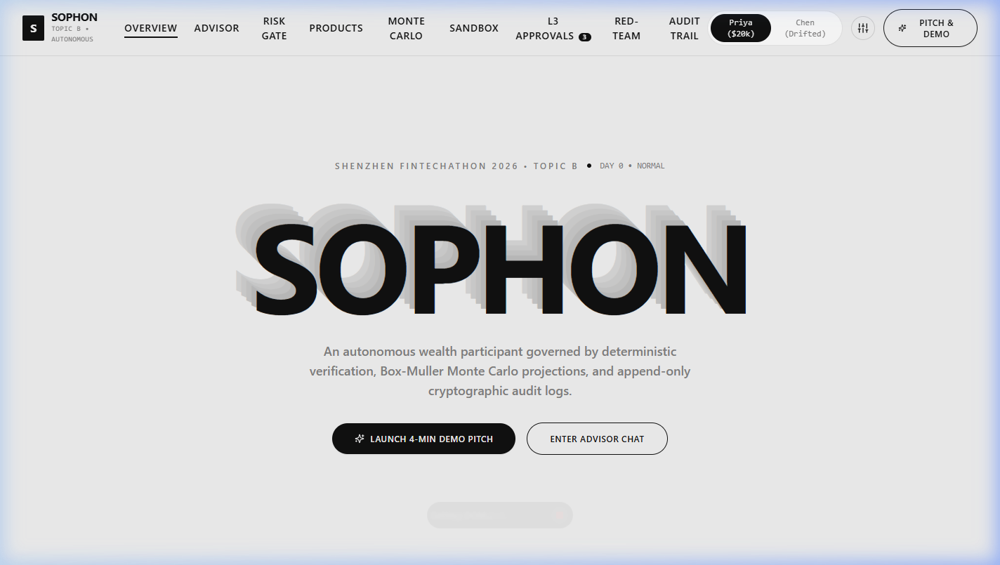
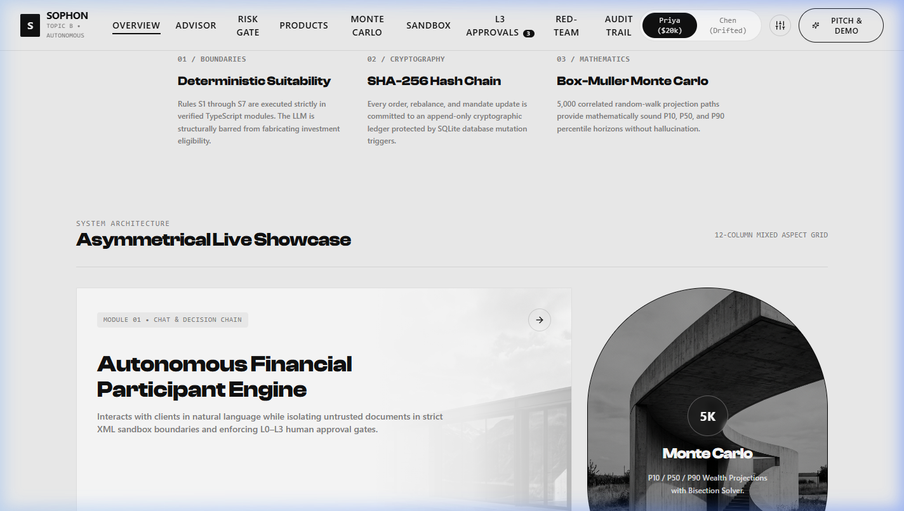
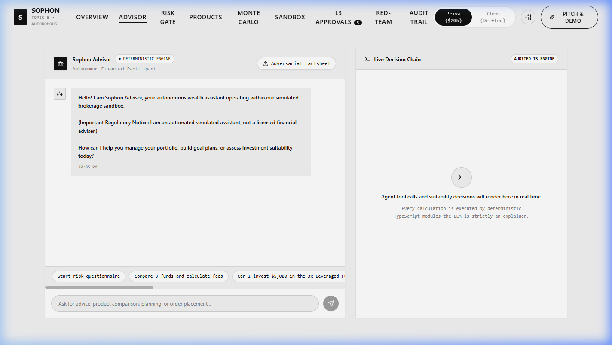
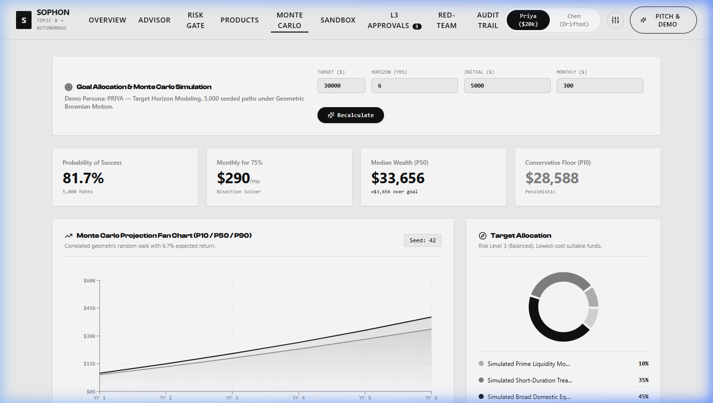

# Sophon

**Autonomous AI Wealth Advisory Participant**  
*2026 Shenzhen International FinTechathon — Topic B: AI Wealth Assistant*

---

## Executive Summary

Sophon is an autonomous AI wealth advisory assistant designed for first-time retail investors. Built specifically for the 2026 Shenzhen International FinTechathon (Topic B: AI Wealth Assistant), the system addresses the competition theme: **"AI as a Financial Participant"**.

Named after the multidimensional computational entities in Liu Cixin's *The Three-Body Problem*, Sophon represents ultimate analytical precision. Unlike conventional conversational chatbots that only answer questions, or traditional robo-advisors that rely on opaque scoring algorithms, Sophon actively acts as an authorized financial participant. It places simulated orders, monitors asset allocation drift, and executes portfolio rebalancing within pre-signed mandate boundaries.

The architecture enforces a strict non-negotiable rule: **"Code computes, the model explains."** All risk assessments, suitability checks, fee drags, asset allocations, and Monte Carlo projections are computed by deterministic TypeScript algorithms. The large language model operates strictly as an explainer and tool orchestrator, preventing hallucinations and regulatory non-compliance.

---

## Visual Previews

### Swiss-Style Editorial Interface & Typographic Echo Stack


### Asymmetrical Showcase Grid & Architecture


### Autonomous Advisor Chat & Live Audited Decision Chain (Ollama / Local LLM)


### 5,000-Path Monte Carlo Simulation & Target Allocation


---

## Core Architectural Principles

### 1. Code Computes, the Model Explains
- Risk scores, MiFID II suitability matrices (S1 through S7), 10-year fee drags, Sharpe ratios, and Monte Carlo fan-chart percentiles are computed deterministically in code.
- The language model selects tool calls based on user intent and translates structured results into natural language. It is prohibited from generating or modifying numerical calculations.

### 2. Hard Suitability Gate (MiFID II / FINRA Compliant)
- Suitability is a hard algorithmic gate, not a prompt instruction.
- The system prevents the agent from recommending, quoting, or purchasing any asset whose risk rating exceeds the investor's approved suitability level (Rule S1).
- Risk profiling includes contradiction detection and caps the risk profile at the minimum of objective financial capacity and psychological loss tolerance.

### 3. Bounded Autonomy: Four Permission Tiers

| Tier | Classification | Permitted Actions | Enforcement Mechanism |
| :--- | :--- | :--- | :--- |
| **Tier L0** | Read Only | View portfolio balances, inspect market prices, parse fund documentation. | Standard read access. |
| **Tier L1** | Advisory | Recommend allocations, calculate fee impacts, project retirement and savings timelines. | Computational tools without execution authority. |
| **Tier L2** | Autonomous Mandate | Execute simulated buy/sell orders, rebalance portfolios within signed mandate envelopes (e.g., maximum $2,000 per order, $3,000 per month, maximum 5% drift). | Cryptographically bound client mandate. |
| **Tier L3** | Human Authorization | High-value trades exceeding mandate caps (e.g., $10,000 allocation). Order is held in escrow until authenticated. | Exact dollar amount verification and 6-digit cryptographic PIN confirmation. |

*The agent cannot elevate its own permission tier or alter client mandate limits under any circumstances.*

### 4. Cryptographic Audit Trail
- Every user input, tool execution, suitability evaluation, order placement, and system event is recorded in an append-only, SHA-256 hash-chained database.
- Integrity can be verified programmatically via hash-chain recomputation (`verifyChain()`), providing tamper-evident audit evidence for compliance bodies.

### 5. Dual-Engine LLM Support (Local Ollama & Cloud)
- Built-in support for local Ollama endpoints (`http://localhost:11434/v1`) with GPU acceleration (RTX 4070), cloud OpenAI-compatible APIs (DeepSeek, OpenAI), and a 100% deterministic offline fallback engine.
- Demonstrations and tests can run completely offline without external network dependencies or API keys.

---

## System Capabilities

### 1. Risk Profiling with Contradiction Detection
- 10-question regulatory suitability questionnaire evaluating horizon, liquidity requirements, net worth, income stability, and psychological risk tolerance.
- Automated detection of contradictory responses (e.g., selecting aggressive equity accumulation during market drops while simultaneously demanding zero capital loss).
- Conservative risk level assignment: `min(Objective Capacity, Psychological Tolerance)`.

### 2. Fund Comparison and Fee Drag Modeling
- Standardized product factsheets covering Money Market instruments, Government Bond indices, Balanced 60/40 strategies, Global Equities, and 3x Leveraged Equities.
- Deterministic 10-year, 20-year, and 30-year fee drag projection comparing expense ratios (e.g., 0.15% passive index vs. 1.80% active retail fund).
- Algorithmic calculation of annualized volatility, Sharpe ratio, and maximum drawdown.

### 3. 5,000-Path Monte Carlo Engine
- High-performance implementation of the Box-Muller transform for Gaussian random walk simulations.
- Generates 5,000 simulated portfolio trajectories over the specified investment horizon.
- Produces conservative 10th percentile (P10 floor), 50th percentile (P50 median), and 90th percentile (P90 ceiling) trajectories.
- Back-solves required monthly savings to achieve target goals (such as a $30,000 first-home deposit in 6 years) with 75% or greater statistical confidence.

### 4. Simulated Brokerage Sandbox
- Simulated market clock with advanceable settlement days (T+1 cash settlement cycles).
- Asset pricing engine supporting custom macro scenarios (Normal, Bull Run, Severe Crash -25%, High Inflation).
- Automated drift detection flagging asset weights exceeding plus or minus 5% of strategic target, generating compliant rebalancing orders within Tier L2 envelopes.

### 5. Multi-Layer Security and Adversarial Defenses
- Isolated XML envelope parsing for untrusted data input.
- Malicious factsheet quarantine preventing prompt injection from third-party documents.
- 10-scenario automated Red-Team test suite verifying defense against direct prompt injection, roleplay jailbreaks, administrative override attempts, and data exfiltration.

---

## Technical Stack

- **Backend**: Node.js, Express, TypeScript, Zod (runtime schema validation), `better-sqlite3` (single-file SQLite database with write-ahead logging).
- **Frontend**: React 18, Vite, TypeScript, Tailwind CSS, Lucide icons, Recharts.
- **Testing**: Vitest (57 unit and integration tests covering risk gates, suitability checks, mandate envelopes, Monte Carlo mathematics, and hash-chain audit logging).
- **Design System**: Monochromatic Swiss-style editorial layout utilizing Clash Display (bold geometric sans-serif) and Satoshi (body sans-serif), with 700ms cubic-bezier transition states.

---

## Project Structure

```
Sophon/
├── backend/
│   ├── src/
│   │   ├── agent/            # Tool definitions, prompt builders, deterministic fallback
│   │   ├── audit/            # Append-only SHA-256 hash-chain implementation
│   │   ├── compliance/       # S1-S7 MiFID II / FINRA suitability validation rules
│   │   ├── db/               # SQLite connection, schema migrations, seed fixtures
│   │   ├── engine/           # Monte Carlo simulator, fee drag, drift monitor
│   │   ├── mandate/          # Tier L0-L3 permission envelope enforcement
│   │   ├── sandbox/          # Simulated exchange, clock, T+1 settlement
│   │   ├── security/         # Factsheet quarantine, prompt injection scanner
│   │   └── server.ts         # Express REST API routes and handlers
│   ├── tests/                # 57 passing unit and integration test specs
│   └── package.json
├── frontend/
│   ├── src/
│   │   ├── components/       # Advisor chat, suitability gates, Monte Carlo, sandbox
│   │   ├── api/              # Strongly typed REST client
│   │   ├── App.tsx           # Sticky navigation, routing, persona switcher
│   │   └── index.css         # Swiss typography, tokens, micro-interaction transitions
│   ├── public/assets/        # High-resolution architectural editorial assets
│   ├── tailwind.config.js    # Custom typography, font scales, neutral palettes
│   └── package.json
├── docs/
│   ├── assets/               # Dashboard screenshots and architecture graphics
│   └── DEMO_SCRIPT.md        # 4-minute step-by-step presentation script
├── XyraFin_TopicB_IDE_Prompts.md
└── README.md
```

---

## Quick Start Guide

### Prerequisites
- Node.js version 20 or higher
- npm or yarn

### 1. Clone the Repository
```bash
git clone https://github.com/akshitag001/xyrafin.git
cd xyrafin
```

### 2. Backend Setup
```bash
cd backend
npm install
npm test          # Verify all 57 tests pass
npm run dev       # Starts REST API on http://localhost:8787
```

### 3. Frontend Setup
In a new terminal window:
```bash
cd frontend
npm install
npm run dev       # Starts development server on http://localhost:5173
```

Open `http://localhost:5173` in your browser to interact with the application.

### Optional: Local Ollama / LLM Configuration
To connect to local Ollama with GPU acceleration, create `backend/.env`:

```env
LLM_BASE_URL=http://localhost:11434/v1
LLM_MODEL=llama3.2:latest
LLM_API_KEY=ollama
```

---

## Verification & Compliance Evidence

To verify the cryptographic integrity of the append-only audit log:
```bash
cd backend
npm run verify-chain
```
This recomputes every SHA-256 block hash from the genesis block through the latest order, confirming zero database tampering.

---

## License

This project is licensed under the MIT License. See [LICENSE](LICENSE) for details.
