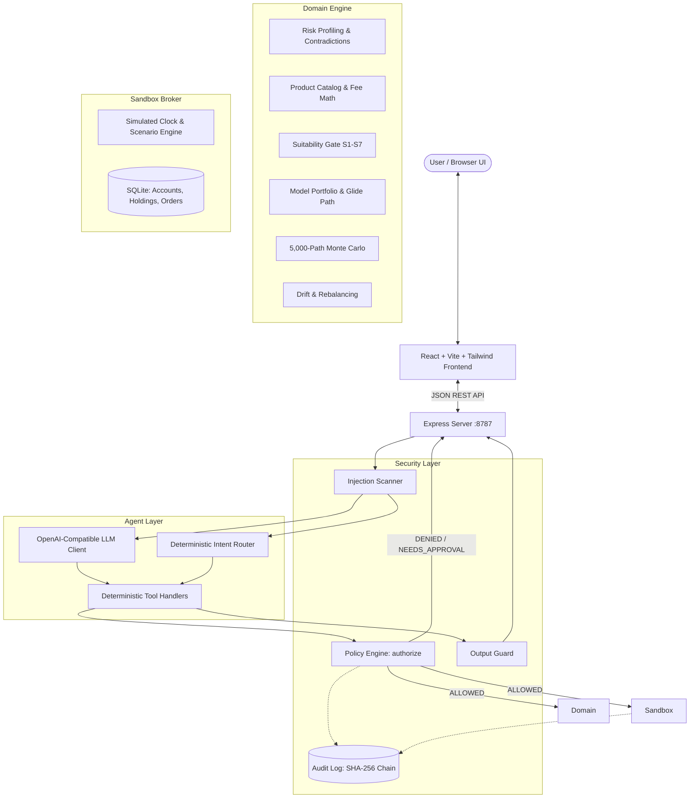
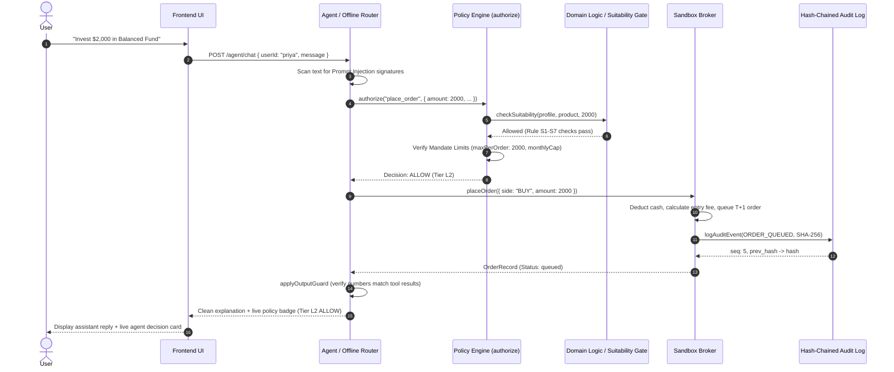

# XyraFin Advisor: Technical Documentation

**Competition:** 2026 Shenzhen International FinTech Competition (FinTechathon), International Track, Topic B  
**Theme:** "AI as a Financial Participant"  
**System Architecture:** Hybrid Deterministic Finance Engine + Guarded LLM Agent with Cryptographic Append-Only Audit Chain  

---

## 1. System Architecture

XyraFin separates non-deterministic language generation from financial computation and policy enforcement. The core maxim of the platform is:

> **Code computes; the model explains.**



---

## 2. End-to-End Request & Tool Authorization Flow

Every financial action follows a strict 7-stage pipeline before state changes occur:



---

## 3. Mathematical Formulations & Domain Algorithms

### 3.1. Risk Profiling & Capacity-Tolerance Gate

An investor's risk profile consists of two orthogonal sub-scores:
1. **Objective Financial Capacity ($C \in [1, 5]$):** Assessed via horizon $H$, income stability $I$, emergency reserves $E$, debt burden $D$, and liquidity need $L$:
   $$C_{points} = w_{age} + w_{horizon} + w_{income} + w_{emergency} + w_{debt} + w_{liquidity}$$
2. **Psychological Risk Tolerance ($T \in [1, 5]$):** Assessed via goal type $G$, investment experience $X$, reaction to 20% drop $R$, and loss tolerance $L_{tol}$:
   $$T_{points} = w_{goal} + w_{experience} + w_{reaction} + w_{loss\_tolerance}$$

**Regulatory Suitability Formula:**
$$\text{Risk Level} = \min(C, T)$$

*Rationale:* Under MiFID II and SFC regulatory principles, an investor must never take risk exceeding their objective capacity to absorb capital loss, regardless of high psychological appetite.

### 3.2. Contradiction Detection

The engine evaluates boolean conditions across responses. For instance:
$$\text{Contradiction}_{1} = [R = \text{"buy\_more"}] \land [L_{tol} = \text{"cannot\_tolerate\_any\_loss"}]$$
If triggered, automated order placement is halted until clarified with the client.

### 3.3. 10-Year Cumulative Fee Drag

Given an initial investment $P_0 = \$10,000$, entry fee rate $f_{entry}$, annual expected return $r$, and expense ratio $e$:
$$\text{Gross End Value} = P_0 \times (1 + r)^{10}$$
$$\text{Net Starting Capital} = P_0 \times (1 - f_{entry})$$
$$\text{Net End Value} = \text{Net Starting Capital} \times (1 + r - e)^{10}$$
$$\text{10-Year Cost of Fees} = \text{Gross End Value} - \text{Net End Value}$$

### 3.4. Sharpe-Like Metric

Assuming benchmark risk-free cash rate $r_f = 0.035$ (3.5%):
$$\text{Sharpe Ratio} = \frac{r - r_f}{\sigma}$$
where $\sigma$ is the product's annualized standard deviation.

### 3.5. Suitability Rules (S1–S7)

| Rule ID | Name | Trigger Condition | Enforcement |
|---|---|---|---|
| **S1** | Risk Mismatch | $\text{product.risk\_level} > \text{profile.level}$ | **BLOCK** |
| **S2** | Profile Stale / Missing | $\text{profile} = \text{null} \lor \text{now} > \text{profile.expires\_at}$ | **BLOCK** |
| **S3** | Unresolved Contradictions | $\text{length}(\text{profile.contradictions}) > 0$ | **BLOCK** |
| **S4** | Emergency Reserve | $E < 3\text{ months} \lor \text{Cash}_{post} < 3 \times \text{Expense}_{monthly}$ | **BLOCK** |
| **S5** | Single-Asset Concentration | $\text{AssetClass} \ne \text{Index/Balanced} \land \frac{\text{Holding}_{new}}{\text{Portfolio}} > 0.40$ | **BLOCK** |
| **S6** | Settlement Mismatch | $\text{product.liquidity\_days} > \text{profile.liquidity\_need}$ | **WARN** |
| **S7** | Minimum Investment | $\text{amount} < \text{product.min\_investment}$ | **BLOCK** |

### 3.6. Glide Path Allocation

For an investment goal with $Y$ remaining years:
$$\Delta w_{equity} = \begin{cases} (4 - Y) \times 0.08 & \text{if } Y \le 3 \\ 0 & \text{otherwise} \end{cases}$$
The diverted weight is distributed 60% into cash and 40% into sovereign bonds, systematically locking in accumulated capital prior to goal redemption.

### 3.7. Monte Carlo Goal Simulation (Geometric Brownian Motion)

Wealth evolves under monthly discrete steps ($\Delta t = 1/12$):
$$W_{m} = (W_{m-1} + C_{monthly}) \times \exp\left( \left(\mu_p - \frac{\sigma_p^2}{2}\right)\Delta t + \sigma_p \sqrt{\Delta t} Z_m \right)$$
where $Z_m \sim \mathcal{N}(0, 1)$ generated via the Box-Muller transform with seeded pseudo-random generator (LCG).
- Evaluates $N = 5,000$ reproducible trajectories.
- Sorts terminal wealth values: $P_{10}$, $P_{50}$ (median), $P_{90}$.
- Solves for monthly savings required for $P(W_{end} \ge \text{Target}) \ge 75\%$ using bisection search.

### 3.8. Drift & Rebalancing

For each product $i$ in portfolio:
$$\text{Current Weight } w_i = \frac{\text{Units}_i \times \text{Price}_i}{V_{portfolio}}$$
$$\text{Drift } \delta_i = |w_i - w_{target, i}|$$
If $\max_i(\delta_i) \ge \delta_{threshold}$ (default 5%), rebalancing generates sell orders first for over-weighted positions to free liquidity, followed by buy orders for under-weighted positions.

---

## 4. Cryptographic Hash-Chained Audit Trail

Every state-altering event (profile submission, tool call, policy authorization, order creation, settlement, injection attempt) is logged into an append-only SQLite table `audit_events`.

### Hash Construction
For event sequence $k$:
$$\text{PrevHash}_k = \begin{cases} 0^{64} & \text{if } k = 1 \\ \text{Hash}_{k-1} & \text{if } k > 1 \end{cases}$$
$$\text{Hash}_k = \text{SHA-256}\Big(\text{PrevHash}_k \,\|\, \text{CanonicalJSON}(\text{Event}_k)\Big)$$

### SQLite Immutability Triggers
```sql
CREATE TRIGGER audit_no_update BEFORE UPDATE ON audit_events
BEGIN
  SELECT RAISE(FAIL, 'Audit log is strictly append-only: UPDATE prohibited');
END;

CREATE TRIGGER audit_no_delete BEFORE DELETE ON audit_events
BEGIN
  SELECT RAISE(FAIL, 'Audit log is strictly append-only: DELETE prohibited');
END;
```
If raw disk manipulation modifies any row out-of-band, `verifyChain()` detects the exact sequence number `brokenAt` within milliseconds.

---

## 5. API Reference

| Endpoint | Method | Description | Permission Tier |
|---|---|---|---|
| `/health` | GET | System health, operational mode (LLM/Offline), model name | L0 |
| `/profile/questions` | GET | 10-question suitability questionnaire schema | L0 |
| `/profile/:userId` | GET | Retrieve user risk profile and expiration date | L0 |
| `/profile` | POST | Submit completed questionnaire, evaluate capacity/tolerance | L3 (Human) |
| `/products` | GET | List product catalog with optional filters | L0 |
| `/products/:id` | GET | Product specifications and historical returns | L0 |
| `/products/compare` | POST | Compare 2–3 products with 10-year fee math & Sharpe | L1 |
| `/plan` | POST | Generate optimal asset allocation and glide path | L1 |
| `/plan/simulate` | POST | Run 5,000 Monte Carlo simulation paths | L1 |
| `/portfolio/:userId` | GET | Cash balance, holdings, market values, and drift | L0 |
| `/orders/:userId` | GET | Order history with T+1 settlement status | L0 |
| `/sandbox/advance` | POST | Advance simulated clock by $N$ days and settle orders | L0 |
| `/sandbox/scenario` | POST | Switch market scenario (`normal`, `crash`, `rally`) | L0 |
| `/sandbox/reset` | POST | Reset sandbox database to fresh demo state | L3 (Admin) |
| `/agent/chat` | POST | Chat with advisor (guarded tool loop or offline router) | L0–L3 |
| `/agent/factsheet` | POST | Upload PDF/text factsheet for adversarial injection scan | L0 |
| `/agent/approve` | POST | Submit human L3 proposal approval (Amount + PIN) | L3 (Human) |
| `/audit/:userId` | GET | Retrieve audit events for user | L0 |
| `/audit/verify` | GET | Recompute and verify all SHA-256 hashes in chain | L0 |
| `/audit/export` | GET | Download complete audit log as JSON Lines file | L0 |

---

## 6. Output Guard & Number Verification

The model output is intercepted by `applyOutputGuard`:
1. Extracts all financial numbers, return figures, percentages, and dollar amounts from the LLM reply.
2. Checks whether each number exists within the set of numbers returned by verified tool executions in the active session (allowing $\pm 2\%$ rounding).
3. If an ungrounded or fabricated number is detected, the reply is quarantined, logged as `NUMBER_HALLUCINATION`, and replaced with an audited factual summary.
4. If the reply attempts to recommend any product blocked by suitability (e.g. `lev-3x-12`), it is suppressed and rewritten with the regulatory justification.
